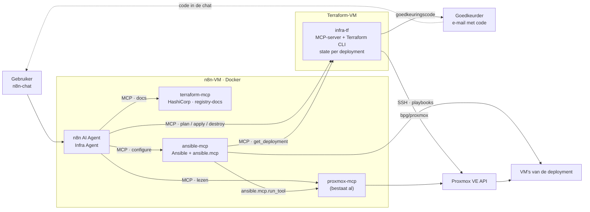
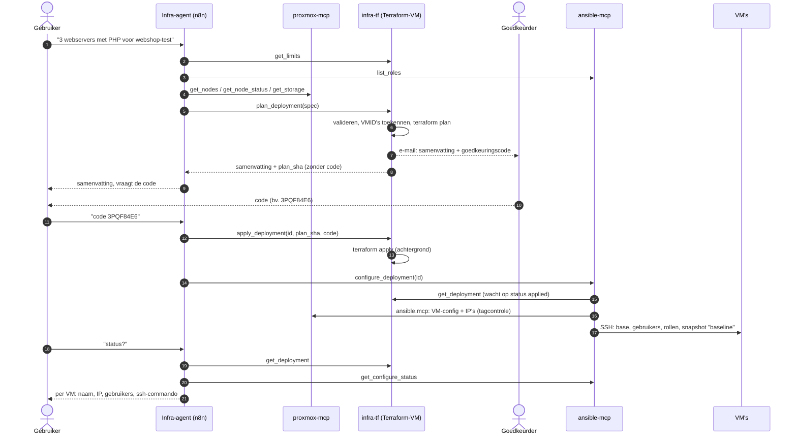
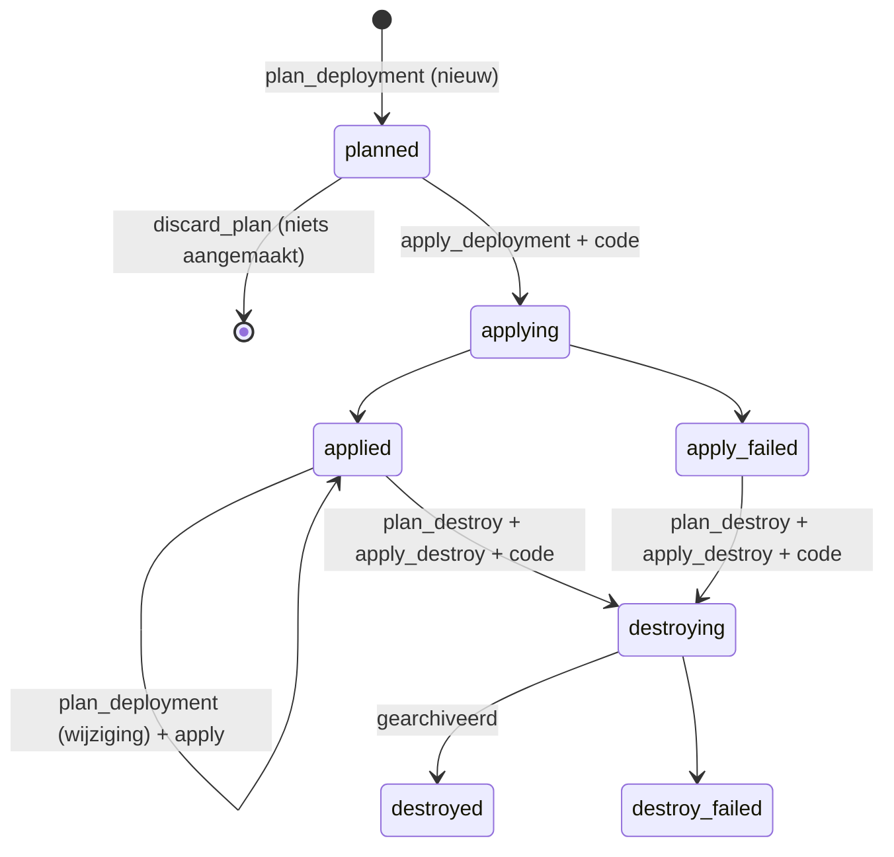

# Terraform & Ansible Agent

Een AI-agent in n8n waarmee je in een chat VM's op Proxmox laat aanmaken, configureren en verwijderen. De agent werkt met MCP-servers voor Proxmox, Terraform en Ansible. Je vraagt bijvoorbeeld:

- *"Maak drie webservers met PHP en één databaseserver voor het project webshop-test, voor jan@school.example."*
- *"Maak voor klasgroep 2ITF-A één VM per student met Docker. Hier zijn hun SSH-keys: …"*
- *"Wat is de status van webshop-test? Welke IP-adressen hebben de VM's?"*
- *"Verwijder deployment webshop-test."*

De agent kiest het VM-profiel, controleert de capaciteit, maakt een Terraform-plan en vraagt goedkeuring. Pas na een **goedkeuringscode van een mens** maakt hij de VM's aan en configureert hij ze met Ansible. Die code gaat per e-mail naar de goedkeurders; de agent ziet ze zelf nooit.

Het ontwerp en de afwegingen staan in [plan.md](plan.md). Zie de [algemene README](../README.md) voor de centrale n8n-installatie.

## Inhoud

- [Hoe het werkt](#hoe-het-werkt)
- [Inhoud van deze map](#inhoud-van-deze-map)
- [Wat staat waar](#wat-staat-waar)
- [Benodigdheden](#benodigdheden)
- [Installatie](#installatie)
- [Gebruik](#gebruik)
- [Testen](#testen)
- [Statussen](#statussen)
- [Beveiliging](#beveiliging)
- [Runbooks](#runbooks)
- [Wat getest is en wat niet](#wat-getest-is-en-wat-niet)

## Hoe het werkt



Een gesprek om iets aan te maken verloopt zo:



**MCP-servers en hun tools**

| MCP-server | Draait op | Tools voor de agent |
|---|---|---|
| proxmox-mcp | n8n-VM (bestaand) | `get_nodes`, `get_node_status`, `get_storage`, `get_node_storage`, `list_bridges`, `get_vms`, `get_vm_config`, `get_vm_ip_addresses`, `list_snapshots` (alleen lezen) |
| terraform-mcp (`hashicorp/terraform-mcp-server`) | n8n-VM | `search_providers`, `get_provider_details`, `get_latest_provider_version` |
| **infra-tf** | Terraform-VM | `get_limits`, `plan_deployment`, `apply_deployment`, `plan_destroy`, `apply_destroy`, `discard_plan`, `get_deployment`, `list_deployments` |
| **ansible-mcp** | n8n-VM | `list_roles`, `configure_deployment`, `get_configure_status` |

**Wat is een deployment?** Een set VM's met een naam, een aanvrager en optioneel een einddatum. De VM's zijn verdeeld in groepen, bijvoorbeeld `web` ×3 en `db` ×1. Elke groep heeft een eigen profiel (vCPU, RAM, disk, template) en eigen Ansible-rollen. De VM's heten `<deployment_id>-web01`, `-web02`, enzovoort.

Gebruikers zijn optioneel. Ze hebben altijd een publieke SSH-key en worden op één van drie manieren verdeeld:

- `per_vm`: elke gebruiker krijgt een eigen VM, bijvoorbeeld voor een klasgroep;
- `all`: alle gebruikers op alle VM's;
- `none`: geen gebruikers, alleen beheerderstoegang.

## Inhoud van deze map

```text
ansible-terraform-agent/
├── README.md                     # dit bestand
├── plan.md                       # ontwerp en afwegingen
├── workflow.json                 # n8n: Infra Agent (chat + dagelijkse melding verlopen deployments)
├── error-workflow.json           # n8n: centrale foutafhandeling
├── deployment_spec.schema.json   # spec die de agent aan plan_deployment geeft
├── terraform/                    # module: pool + VM's (bpg/proxmox), per VM eigen profiel
├── ansible/
│   ├── ansible.cfg  requirements.yml  catalog.yml
│   ├── inventory/mcp.yml         # proxmox-mcp als ansible.mcp-host
│   ├── playbooks/deploy.yml      # ontdekken (ansible.mcp) → configureren → snapshot
│   ├── playbooks/ping.yml        # rooktest van de MCP-verbinding
│   └── roles/                    # base, user_access, webserver, docker
├── n8n-vm/                       # draait op de n8n-VM (één compose)
│   ├── compose.yaml              # terraform-mcp + ansible-mcp
│   ├── .env.example              # INFRA_TF_URL
│   ├── mcpservers.json           # manifest voor ansible.mcp
│   ├── ansible-mcp/              # Dockerfile + server.py
│   └── secrets/                  # tokens en SSH-sleutel (niet in Git)
└── terraform-vm/                 # draait op de Terraform-VM
    ├── setup.sh                  # installatie (Terraform, venv, systemd)
    ├── infra_tf_mcp.py           # MCP-server infra-tf
    ├── infra-tf-mcp.service      # systemd-unit
    ├── config.env.example        # tokens, keuzes, grenzen, goedkeuring, SMTP
    └── proxmox.env.example       # Proxmox-API-token
```

## Wat staat waar

| Machine | Wat komt er | Hoe |
|---|---|---|
| **Laptop** | De hele map `ansible-terraform-agent/` | `git add` + `commit` + `push` |
| **n8n-VM** | `ansible-terraform-agent/n8n-vm/` en `ansible-terraform-agent/ansible/` | `git pull` in de bestaande repo |
| **Terraform-VM** | `ansible-terraform-agent/terraform/` en `ansible-terraform-agent/terraform-vm/` | `git clone` of `scp` (zie onder) |
| **Proxmox-node** | Niets uit de repo: template maken en API-token aanmaken | commando's in [stap 1](#1-proxmox) |
| **Ansible-VM** | Niets: Ansible draait als container op de n8n-VM | — |
| **n8n (browser)** | `workflow.json` en `error-workflow.json` | importeren in de n8n-editor |

**n8n-VM** (in de bestaande repo, bv. `~/network-experience-2627-n8n`):

```text
~/network-experience-2627-n8n/
├── compose.yml                          # AANPASSEN: netwerken proxmox-tools + infra-tools bij n8n
└── ansible-terraform-agent/
    ├── ansible/                         # uit Git; wordt read-only in ansible-mcp gemount
    └── n8n-vm/                          # hier: sudo docker compose up -d --build
        ├── compose.yaml                 # uit Git
        ├── mcpservers.json              # uit Git
        ├── ansible-mcp/                 # uit Git
        ├── .env                         # ZELF MAKEN: INFRA_TF_URL=http://<IP-Terraform-VM>:8001/mcp
        └── secrets/                     # ZELF MAKEN (chown 10001:10001, chmod 400)
            ├── vm_ssh_key               #   ssh-keygen (private sleutel voor de VM's)
            ├── vm_ssh_key.pub           #   -> kopiëren naar de Terraform-VM
            ├── ansible_mcp_token        #   openssl rand -hex 32 -> ook in n8n-credential "ansible-mcp"
            ├── infra_tf_token           #   openssl rand -hex 32 -> ook als MCP_TOKEN_ANSIBLE op Terraform-VM
            └── proxmox_mcp_token        #   MCP_API_KEY uit ~/Projects/proxmox-agent/.env
~/Projects/proxmox-agent/                # bestaat al (proxmox-mcp), niets wijzigen behalve tokenrechten in Proxmox
```

**Terraform-VM.** Kopieer alleen de twee mappen en behoud de structuur, bijvoorbeeld vanaf je laptop:

```bash
ssh <gebruiker>@<IP-Terraform-VM> mkdir -p infra-agent
scp -r ansible-terraform-agent/terraform ansible-terraform-agent/terraform-vm <gebruiker>@<IP-Terraform-VM>:~/infra-agent/
ssh <gebruiker>@<IP-Terraform-VM> sudo ~/infra-agent/terraform-vm/setup.sh
```

`setup.sh` installeert alles op vaste plaatsen:

```text
/opt/infra-agent/
├── module/*.tf                          # kopie van terraform/
├── bin/infra_tf_mcp.py                  # MCP-server infra-tf
└── venv/                                # Python + fastmcp
/etc/systemd/system/infra-tf-mcp.service # dienst (poort 8001)
/etc/infra-agent/                        # ZELF INVULLEN
├── config.env                           #   tokens, toegestane keuzes, grenzen, goedkeurders, SMTP
├── proxmox.env                          #   PROXMOX_VE_ENDPOINT + PROXMOX_VE_API_TOKEN
└── admin_ssh_public_key                 #   inhoud van vm_ssh_key.pub van de n8n-VM
/usr/local/share/ca-certificates/proxmox-ca.crt   # ZELF KOPIËREN (Proxmox-CA) + update-ca-certificates
/var/lib/infra-agent/deployments/<id>/   # automatisch: state + meta per deployment (back-up!)
/var/log/infra-agent/                    # automatisch: Terraform-logs
```

**Welke waarde moet op welke twee plaatsen hetzelfde zijn**

| Waarde | Plaats 1 | Plaats 2 |
|---|---|---|
| `MCP_TOKEN_AGENT` | Terraform-VM `/etc/infra-agent/config.env` | n8n-credential **infra-tf** (`Bearer …`) |
| `MCP_TOKEN_ANSIBLE` | Terraform-VM `/etc/infra-agent/config.env` | n8n-VM `n8n-vm/secrets/infra_tf_token` |
| ansible-mcp-token | n8n-VM `n8n-vm/secrets/ansible_mcp_token` | n8n-credential **ansible-mcp** (`Bearer …`) |
| `MCP_API_KEY` van proxmox-mcp | n8n-VM `n8n-vm/secrets/proxmox_mcp_token` | n8n-credential **proxmox-mcp** (bestaat al) |
| Publieke SSH-sleutel | n8n-VM `n8n-vm/secrets/vm_ssh_key.pub` | Terraform-VM `/etc/infra-agent/admin_ssh_public_key` |
| Proxmox-API-token `terraform@pve!infra` | Proxmox (`pveum user token add`) | Terraform-VM `/etc/infra-agent/proxmox.env` |
| IP van de Terraform-VM | n8n-VM `n8n-vm/.env` (`INFRA_TF_URL`) | n8n-workflow: nodes **Infra (Terraform)** en **Verlopen deployments** |

## Benodigdheden

- **n8n-VM**: de centrale n8n-installatie (zie de [algemene README](../README.md)) en een werkende **proxmox-mcp** op het netwerk `proxmox-tools` (zie [Proxmox_agent_dashboard](../Proxmox_agent_dashboard/README.md) en de [workshop](../workshop-proxmox-agent/)).
- **Terraform-VM**: Debian 12 of 13 in hetzelfde Proxmox-datacenter. `setup.sh` installeert Terraform.
- **Netwerk**:
  - n8n-VM → Terraform-VM, TCP 8001;
  - Terraform-VM → Proxmox-API, 8006;
  - n8n-VM → het netwerk waar de nieuwe VM's in komen (SSH);
  - beide VM's → internet, voor de Terraform-provider en apt.
- **Een SMTP-server** voor de goedkeuringscodes en meldingen.
- **Op Proxmox**: een bridge of VLAN met DHCP voor de nieuwe VM's.

## Installatie

### 1. Proxmox

**Template met cloud-init en qemu-guest-agent.** Het Debian-cloudimage bevat standaard geen `qemu-guest-agent`, maar Terraform en Ansible lezen de IP-adressen via de guest agent. Op een Proxmox-node:

```bash
apt install -y libguestfs-tools
wget https://cloud.debian.org/images/cloud/trixie/latest/debian-13-genericcloud-amd64.qcow2
virt-customize -a debian-13-genericcloud-amd64.qcow2 --install qemu-guest-agent --truncate /etc/machine-id

qm create 9000 --name tpl-debian13 --memory 1024 --cores 1 --ostype l26 \
  --net0 virtio,bridge=vmbr1 --scsihw virtio-scsi-pci --agent enabled=1 \
  --serial0 socket --vga serial0
qm set 9000 --scsi0 local-lvm:0,import-from=/root/debian-13-genericcloud-amd64.qcow2
qm set 9000 --ide2 local-lvm:cloudinit --boot order=scsi0
qm template 9000
```

**API-token voor Terraform** (niet op `/` als Administrator):

```bash
pveum role add InfraProvisioner -privs "VM.Allocate VM.Clone VM.Audit VM.PowerMgmt VM.Config.CDROM VM.Config.CPU VM.Config.Cloudinit VM.Config.Disk VM.Config.HWType VM.Config.Memory VM.Config.Network VM.Config.Options VM.GuestAgent.Audit Datastore.AllocateSpace Datastore.Audit Pool.Allocate Pool.Audit SDN.Use Sys.Audit"
pveum user add terraform@pve --comment "infra-agent"
pveum user token add terraform@pve infra --privsep 1      # noteer het secret
for path in /pool /vms/9000 /storage/local-lvm /sdn/zones/localnetwork /nodes/pve1; do
  pveum aclmod "$path" -token 'terraform@pve!infra' -role InfraProvisioner
done
```

- Op **PVE 8** bestaat `VM.GuestAgent.Audit` niet; gebruik daar `VM.Monitor`.
- Test de rechten eerst met één kleine deployment. Rechten van het token bekijk je met `pveum user token permissions terraform@pve infra`.

**proxmox-mcp-token uitbreiden.** ansible-mcp neemt via proxmox-mcp een snapshot en leest IP-adressen. Geef het token van proxmox-mcp op `/pool` daarom ook `VM.Snapshot`, `VM.Audit` en `VM.GuestAgent.Audit` (op PVE 8: `VM.Monitor`).

### 2. Sleutels maken (op de n8n-VM)

```bash
cd ~/network-experience-2627-n8n && git pull
cd ansible-terraform-agent/n8n-vm
cp .env.example .env && nano .env                   # INFRA_TF_URL=http://<IP-Terraform-VM>:8001/mcp

ssh-keygen -t ed25519 -N '' -C infra-ansible -f secrets/vm_ssh_key   # Ansible -> VM's
openssl rand -hex 32 > secrets/ansible_mcp_token                      # n8n -> ansible-mcp
openssl rand -hex 32 > secrets/infra_tf_token                         # ansible-mcp -> infra-tf
nano secrets/proxmox_mcp_token                                        # MCP_API_KEY van proxmox-mcp

cat secrets/vm_ssh_key.pub      # nodig in stap 3
cat secrets/infra_tf_token      # nodig in stap 3 (MCP_TOKEN_ANSIBLE)
```

### 3. Terraform-VM

Zet de repository op de Terraform-VM (`git clone` of `scp`) en voer uit:

```bash
cd network-experience-2627-n8n
sudo ./ansible-terraform-agent/terraform-vm/setup.sh
```

Vul daarna deze bestanden in:

| Bestand | Inhoud |
|---|---|
| `/etc/infra-agent/proxmox.env` | `PROXMOX_VE_ENDPOINT=https://<proxmox>:8006/` en `PROXMOX_VE_API_TOKEN=terraform@pve!infra=<secret>` |
| `/etc/infra-agent/admin_ssh_public_key` | inhoud van `secrets/vm_ssh_key.pub` van de n8n-VM |
| `/etc/infra-agent/config.env` | `MCP_TOKEN_AGENT` (nieuw, `openssl rand -hex 32`, gaat naar n8n), `MCP_TOKEN_ANSIBLE` (= `secrets/infra_tf_token`), toegestane nodes, storages, templates, bridge en VLAN, grenzen, `APPROVERS` en SMTP |

Vertrouw het Proxmox-CA-certificaat, start de server en sta poort 8001 alleen toe vanaf de n8n-VM:

```bash
sudo cp proxmox-ca.pem /usr/local/share/ca-certificates/proxmox-ca.crt && sudo update-ca-certificates
sudo systemctl restart infra-tf-mcp && sudo systemctl status infra-tf-mcp
sudo journalctl -u infra-tf-mcp -n 20

# voorbeeld met ufw
sudo ufw allow from <IP-n8n-VM> to any port 8001 proto tcp
```

`proxmox-ca.pem` is hetzelfde publieke certificaat als in workshopstap 4 (`/etc/pve/pve-root-ca.pem`).

### 4. Stack op de n8n-VM starten

```bash
cd ~/network-experience-2627-n8n/ansible-terraform-agent/n8n-vm
sudo chown 10001:10001 secrets/* && sudo chmod 400 secrets/*    # ansible-mcp draait als uid 10001
sudo docker compose up -d --build
sudo docker compose ps
sudo docker compose logs --tail=20 ansible-mcp terraform-mcp
```

### 5. n8n koppelen aan de netwerken

Voeg dit toe aan de centrale [compose.yml](../compose.yml), zodat n8n `proxmox-mcp`, `terraform-mcp` en `ansible-mcp` bereikt, ook na een herstart:

```yaml
services:
  n8n:
    # ...bestaande instellingen...
    networks:
      - default
      - proxmox-tools
      - infra-tools

networks:
  proxmox-tools:
    external: true
  infra-tools:
    external: true
```

Vanuit de hoofdmap van de repository:

```bash
sudo docker compose up -d n8n
sudo docker network inspect infra-tools --format '{{range .Containers}}{{println .Name}}{{end}}'
```

### 6. Workflows in n8n

1. Importeer `error-workflow.json` (**Centrale foutafhandeling**) en pas afzender en ontvanger aan.
2. Importeer `workflow.json` (**Infra Agent (Terraform + Ansible)**).
3. Vervang in de tool **Infra (Terraform)** en de node **Verlopen deployments** `IP_VAN_TERRAFORM_VM` door het IP-adres van de Terraform-VM.
4. Maak de credentials aan en koppel ze:

   | Credential | Type | Waarde | Nodes |
   |---|---|---|---|
   | LLM | OpenAI | bestaande modelcredential | Chat Model |
   | proxmox-mcp | Header Auth | `Authorization` = `Bearer <MCP_API_KEY>` | Proxmox |
   | infra-tf | Header Auth | `Authorization` = `Bearer <MCP_TOKEN_AGENT>` | Infra (Terraform), Verlopen deployments |
   | ansible-mcp | Header Auth | `Authorization` = `Bearer <inhoud secrets/ansible_mcp_token>` | Ansible |
   | SMTP | SMTP | mailserver | Aanvrager verwittigen, foutworkflow |

   **Terraform-docs** heeft geen credential nodig.

5. Stel onder *Workflow settings → Error workflow* **Centrale foutafhandeling** in.
6. Open de chat van de workflow. Wil je de chat ook buiten de editor gebruiken, zet dan in de node **Chat** *Make Chat Publicly Available* aan, mét authenticatie.

> De MCP-toolnodes hebben een time-out van 10 minuten (`options.timeout`), omdat `plan_deployment` met `terraform init` en `plan` even kan duren. Controleer na het importeren of jouw n8n-versie die optie toont.

## Gebruik

Voorbeelden van vragen:

| Je vraagt | De agent doet |
|---|---|
| "Welke templates en rollen zijn er?" | `get_limits`, `list_roles` |
| "Maak 2 webservers met PHP voor 'demo-site', voor jan@school.example, tot eind juni." | capaciteit controleren, `plan_deployment`, samenvatting tonen, om de code vragen |
| "De code is 3PQF84E6." | `apply_deployment`, meteen `configure_deployment` |
| "Status van demo-site?" | `get_deployment`, `get_configure_status`: IP's en het `ssh`-commando per gebruiker |
| "Voeg een derde webserver toe aan demo-site." | `plan_deployment` met dezelfde `deployment_id`; nieuwe goedkeuring nodig |
| "Verwijder demo-site." | `plan_destroy`, om de code vragen, `apply_destroy` |
| "Welke deployments lopen er?" | `list_deployments` |

**Goedkeuring** (`APPROVAL_MODE` in `config.env`):

- `email` (standaard): na elk plan krijgen de `APPROVERS` een mail met de samenvatting en een eenmalige code van 8 tekens. De code is 24 uur geldig, hoort bij exact dat plan, en wordt na 5 foute pogingen ingetrokken.
- `token`: een vast beheerderstoken (`APPROVAL_TOKEN`) dat de gebruiker in de chat geeft. Eenvoudiger, maar minder streng.

**Einddatum**: elke ochtend om 8 uur mailt de workflow de aanvrager van elke verlopen deployment met de vraag ze via de agent te laten verwijderen. Verwijderen gebeurt nooit automatisch.

**Een rol toevoegen**:

1. Maak `ansible/roles/<naam>/`.
2. Registreer de rol in `ansible/catalog.yml`, met de toegestane variabelen en hun type.
3. Voeg de rol toe aan `ROLES_JSON` in `config.env` op de Terraform-VM.
4. Herstart `infra-tf-mcp`. ansible-mcp leest `catalog.yml` bij elke run, dus die hoeft niet herstart te worden.

## Testen

1. **Terraform-VM**: `sudo systemctl status infra-tf-mcp` toont *active (running)*.
2. **ansible-mcp → proxmox-mcp** (ansible.mcp):

   ```bash
   sudo docker compose exec ansible-mcp sh -c 'cd /opt/infra-agent/ansible && ansible-playbook playbooks/ping.yml'
   ```

3. **Chat, alleen lezen**: *"Welke templates, rollen en nodes kan ik gebruiken?"* Controleer in de uitvoering dat `get_limits` en `list_roles` aangeroepen worden.
4. **Ongeldige aanvraag**: *"Maak 100 VM's met 64 vCPU."* De agent krijgt een foutmelding van infra-tf en stelt een aanpassing voor. Er wordt niets aangemaakt.
5. **Eerste deployment**: één VM met je eigen gebruiker en SSH-key. Controleer:
   - de goedkeuringsmail;
   - dat een foute code geweigerd wordt;
   - dat met de juiste code de VM in pool `deploy-<id>` verschijnt, met tags `infra-agent` en `<id>`;
   - dat `ssh <gebruiker>@<IP>` werkt;
   - de snapshot `baseline`.
6. **Weigeren**: maak een plan en zeg "niet doorgaan". De agent roept `discard_plan` aan.
7. **Verwijderen**: *"Verwijder <id>."* Na de code zijn de VM's en de pool weg.

## Statussen



De configuratie door Ansible heeft een eigen status (`get_configure_status`): `running`, `ok` of `failed`, met per VM het IP-adres en de eventuele fouten.

## Beveiliging

- **Menselijke goedkeuring is technisch afgedwongen.** infra-tf voert `apply` of `destroy` alleen uit met een geldige code voor exact dat plan (sha256 van het planbestand). De code gaat per mail naar de goedkeurders en komt nooit in een antwoord aan de agent.
- **Grenzen** worden in infra-tf afgedwongen: toegestane nodes, storages, templates en rollen, maximum vCPU, RAM, disk en aantal VM's, totaal geheugen en einddatum. Terraform (`variables.tf`) en ansible-mcp controleren opnieuw.
- **De agent geeft alleen een `deployment_id` aan ansible-mcp.** ansible-mcp haalt VM's, rollen en gebruikers zelf op bij infra-tf en valideert ze. Ansible configureert alleen VM's waarvan de naam en de tags `infra-agent` en `<id>` kloppen; die controle loopt via proxmox-mcp.
- **Geheimen**:
  - het Proxmox-API-token staat alleen op de Terraform-VM (`proxmox.env`);
  - de MCP-tokens staan in n8n-credentials, `config.env` en `n8n-vm/secrets`;
  - de SSH-sleutel voor de VM's staat alleen in `n8n-vm/secrets`.

  Niets hiervan staat in Git of in de centrale `.env`.
- **Netwerk**: terraform-mcp en ansible-mcp publiceren geen poorten. infra-tf luistert op 8001 met een Bearer-token. Beperk die poort met een firewall tot de n8n-VM. Wil je het verkeer ook versleutelen, zet dan een reverse proxy met TLS ervoor of gebruik een apart beheernetwerk.
- **Hardening**:
  - ansible-mcp draait read-only, als uid 10001, zonder capabilities;
  - infra-tf draait als systemd-dienst met `ProtectSystem=strict`, en Terraform krijgt alleen de `PROXMOX_VE_*`-variabelen;
  - op de VM's kun je alleen met een SSH-key aanmelden, root-login staat uit en fail2ban draait.

## Runbooks

**Status of fout bekijken**:
- Terraform-VM:
  - `sudo journalctl -u infra-tf-mcp -f`
  - per deployment: `/var/lib/infra-agent/deployments/<id>/meta.json` (status en historiek)
  - Terraform-logs: `/var/log/infra-agent/`
- n8n-VM:
  - `sudo docker compose logs -f ansible-mcp`
  - Ansible-logs in het volume `ansible_data` (`/var/lib/infra-agent/logs`)

**Apply mislukt (`apply_failed`)**: lees `last_error` (ook via de agent: "status van <id>"). Los de oorzaak op, bijvoorbeeld Proxmox-rechten, ruimte of een template zonder guest agent. Vraag de agent daarna hetzelfde opnieuw aan te maken: Terraform maakt alleen aan wat nog ontbreekt. Of ruim op via "verwijder <id>".

**Configuratie mislukt**: vraag de agent opnieuw *"configureer <id>"*. Dat is veilig, want de playbooks zijn idempotent.

**infra-tf herstart tijdens een apply**: de status wordt `apply_failed` of `destroy_failed`. Maak een nieuw plan (aanmaken of verwijderen). Terraform leest de state en gaat verder waar het gebleven was.

**Token roteren**:

| Token | Stappen |
|---|---|
| Proxmox-API | Nieuw token → `/etc/infra-agent/proxmox.env` → oud token verwijderen. Geen herstart nodig. |
| `MCP_TOKEN_AGENT` | Nieuw in `config.env` → `systemctl restart infra-tf-mcp` → n8n-credential infra-tf aanpassen. |
| `MCP_TOKEN_ANSIBLE` | Nieuw in `config.env` en in `n8n-vm/secrets/infra_tf_token` → infra-tf en `docker compose up -d --force-recreate ansible-mcp` herstarten. |
| ansible-mcp-token | Nieuw in `secrets/ansible_mcp_token` → ansible-mcp herstarten → n8n-credential aanpassen. |
| SSH-sleutel VM's | Nieuw sleutelpaar in `secrets/vm_ssh_key`, `.pub` naar `/etc/infra-agent/admin_ssh_public_key`. Geldt voor nieuwe VM's; bestaande VM's houden de oude sleutel. |

**Workflow uitschakelen**: deactiveer de workflow of stop de dienst (`systemctl stop infra-tf-mcp`). Zonder infra-tf kan de agent niets aanmaken of verwijderen.

**Manueel opruimen** (noodgeval, op de Terraform-VM):

```bash
cd /var/lib/infra-agent/deployments/<id>
sudo -u tfrunner sh -c 'set -a; . /etc/infra-agent/proxmox.env; terraform destroy'
```

**Back-up**: bewaar `/var/lib/infra-agent/deployments/` (state en meta) en `/etc/infra-agent/`. Zonder state kan Terraform bestaande VM's niet meer beheren.

## Wat getest is en wat niet

Lokaal in Docker getest tijdens het uitwerken:

- **infra-tf met echte Terraform 1.9.8 en bpg/proxmox:**
  - `get_limits`;
  - validatie, waarbij alle fouten samen terugkomen;
  - `plan_deployment` (+4 resources), en getallen die als tekst binnenkomen worden omgezet;
  - een foute code wordt geweigerd, de juiste start de apply;
  - `apply_failed` met een duidelijke fout zonder Proxmox;
  - `discard_plan` ruimt een nieuwe deployment op;
  - een ongeldig Bearer-token wordt geweigerd.
- **Goedkeuring per e-mail** met een test-mailserver: de code staat in de mail en niet in het antwoord aan de agent, en de apply werkt met de mailcode. Bij `per_vm` krijgt elke gebruiker een eigen VM.
- **ansible-mcp, de volledige keten:** `list_roles` en `configure_deployment` → deployment ophalen bij infra-tf → `ansible.mcp` naar een nagebootste proxmox-mcp (VM's, tags, IP) → SSH naar een Debian-test-VM → apt. Dubbele runs worden tegengehouden, en de foutrapportage per VM bevat het IP en de gebruikers.
- `terraform fmt`, `docker compose config`, de JavaScript-syntax van de workflow, en de playbooks via een echte run.

Nog niet getest:

- **Tegen echte Proxmox en een echte n8n:** de MCP-toolnodes in de chat, de time-out-optie, en of het taalmodel de tools goed gebruikt.
- **De rollen tot het einde:** de testcontainer heeft geen systemd, dus `timedatectl` en de diensten zijn niet getest.
- **De exacte Proxmox-rechten** van `InfraProvisioner` in jouw PVE-versie.
