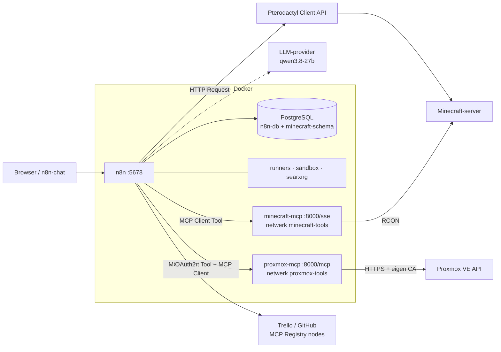
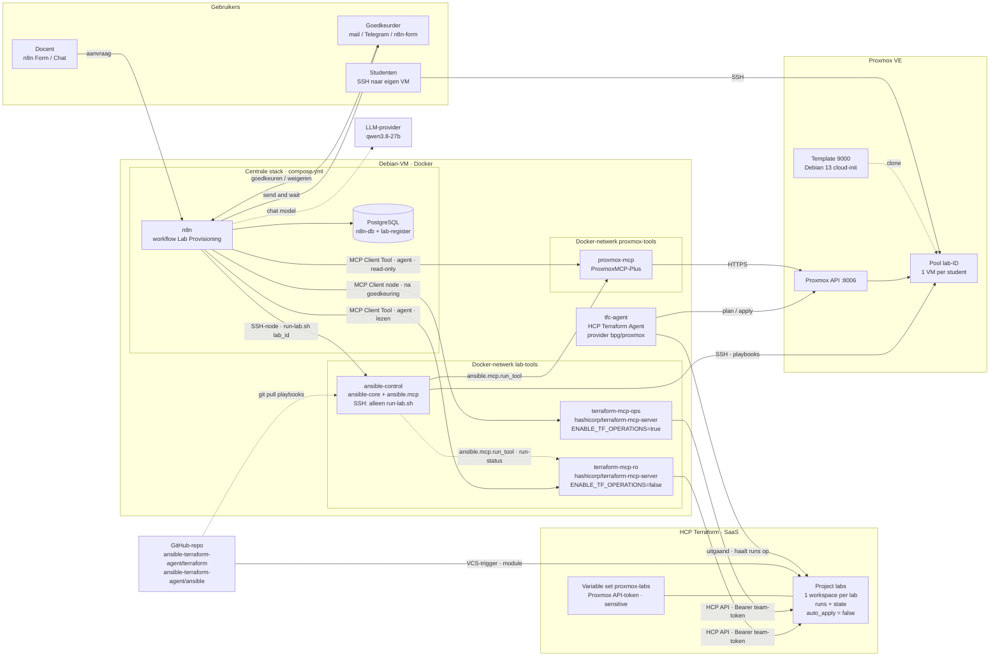
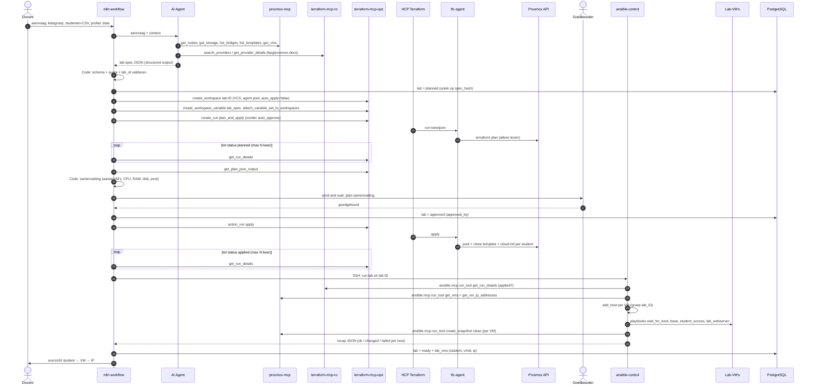
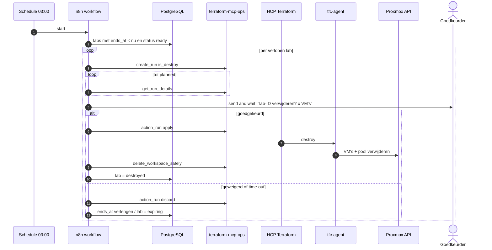
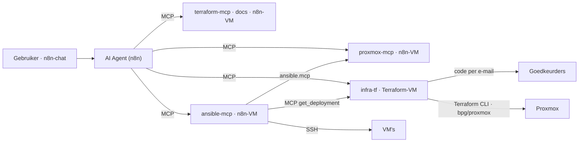

# Plan: Lab-provisioning-agent met Terraform + Ansible via MCP

> Doel: een n8n-workflow met een AI-agent die voor een klasgroep (bv. 24 studenten) automatisch VM's op Proxmox aanmaakt (Terraform) en configureert (Ansible), met menselijke goedkeuring vóór elke impactvolle actie en automatische opruiming na het labo.
>
> Gekozen bouwstenen (bestaande MCP's, geen eigen MCP-servers):
> - [`hashicorp/terraform-mcp-server`](https://github.com/hashicorp/terraform-mcp-server) — MCP-server voor de Terraform Registry en HCP Terraform / Terraform Enterprise (workspaces, variabelen, runs, state).
> - [`ansible-collections/ansible.mcp`](https://github.com/ansible-collections/ansible.mcp) — Ansible-collectie waarmee playbooks MCP-servers aanroepen (`ansible.mcp.run_tool`, `tools_info`, `server_info`, connection plugin `ansible.mcp.mcp`).
> - De bestaande **ProxmoxMCP-Plus** (`proxmox-mcp`) uit deze repo.
>
> Dit document bestaat uit twee delen:
> 1. **Analyse** van de huidige repository.
> 2. **Plan** voor de nieuwe workflow, met Mermaid-schema's van hoe alles samenhangt.

---

## Deel 1 — Analyse van de huidige repository

### 1.1 Overzicht

| Map / bestand | Wat het is | Status |
|---|---|---|
| `compose.yml` | Centrale stack: n8n, PostgreSQL 16, SearXNG, n8n-runners, n8n sandbox (certs/api/runner-dind) | Draait; secrets via één gedeelde `.env` |
| `opdracht.md` | Projectopdracht "n8n Automation Hub" (Must/Should/Could, acceptatietests) | Leidraad voor alle workflows |
| `step1_n8n_installation` | Gids: n8n op Debian-VM (losse compose, SQLite) | Alternatief/oudere opzet |
| `step2_instructions_mcp_client.md` | Gids: n8n + eigen Minecraft-MCP (FastMCP, SSE, RCON) | Basis van het MCP-patroon |
| `Minecraft_dashboard/` | Workflow "Minecraft Whitelist Links" (dashboard, AI-chat, uitnodigingen, Postgres, schedule) + `minecraft-mcp/` (eigen FastMCP-server) | Actief |
| `Minecraft_dashboard/Minecraft_Whitelist_Portal/` | Workflow: studentportal via Authentik (R-nummer), Postgres, semesterreset via cron | Actief |
| `Trello/` | Chat-agent met `@n8n/mcp-registry.trello` + `@n8n/mcp-registry.gitHub` | Inactief |
| `Proxmox_agent_dashboard/` | Proxmox chat-agent + VM-dashboard; `proxmox-agent/` bevat ProxmoxMCP-Plus (vendored) + eigen `compose.yaml` | Actief (live-versie) |
| `workshop-proxmox-agent/` | 6 stappen om ProxmoxMCP-Plus te installeren en aan n8n te koppelen | Documentatie |
| `templates/` | `docker-log-telegram.json`: Telegram-bot + **SSH-nodes** voor Docker-logs/restarts | Niet geïmplementeerd |
| `minecraft-whitelist-schema.sql` | Postgres-schema voor whitelist | Loopt niet gelijk met workflow (zie Minecraft-README) |

### 1.2 Architectuur zoals ze nu is



### 1.3 Terugkerende patronen (hergebruiken in de nieuwe workflow)

1. **MCP-container naast n8n op een eigen Docker-netwerk**, zonder gepubliceerde hostpoort, gehard (`read_only`, `cap_drop: ALL`, `no-new-privileges`, non-root) — zie `minecraft-mcp/compose.yaml`.
2. **Twee manieren om MCP in n8n te gebruiken**
   - `mcpClientTool` aan de AI Agent met `include: selected` + expliciete `includeTools` (de agent kiest zelf).
   - `mcpClient` als gewone node met één vaste tool (`timeout: 180000`) — zie "MCP - VM gegevens". **Dit is het sleutelpatroon voor "agent stelt voor, workflow voert uit".**
3. **Header Auth-credential** `Authorization: Bearer <token>` in n8n; de echte backend-secrets (Proxmox-token) blijven op de MCP-server.
4. **Allowlisting op twee niveaus**: ProxmoxMCP-Plus (`MCP_TOOL_ALLOWLIST`, `command_policy`, `high_risk_operations` + `approval_token`, `client_permissions`) én n8n (`includeTools`).
5. **Webhook + HTML in Code-node** voor dashboards/portals (Basic Auth of JWT).
6. **Postgres als register + Schedule Trigger voor opruiming** (Minecraft: dagelijkse verval-check, semesterreset `0 3 1 2,9 *`).
7. **SSH-node** om commando's op een andere host uit te voeren (`templates/docker-log-telegram.json`).
8. **Authentik/R-nummer** als identiteitsbron voor studenten (Portal-workflow).

### 1.4 Proxmox MCP (ProxmoxMCP-Plus) — relevante mogelijkheden

- Vendored upstream (`RekklesNA/ProxmoxMCP-Plus`) met één lokale uitbreiding: `get_vm_dashboard` (`services/builtin_tool_plugins.py`, blok `LOCAL VM DASHBOARD EXTENSION`, + `dashboard_readonly.py`).
- Configuratie via env (`PROXMOX_*`, `MCP_*`, `COMMAND_POLICY_*`), Streamable HTTP op `proxmox-mcp:8000/mcp`, jobs in SQLite-volume.
- Bruikbaar voor labs: `get_nodes`, `get_storage`, `list_bridges`, `get_vms`, `get_next_vmid`, `list_templates`, `get_vm_ip_addresses`, `create_snapshot`, `rollback_snapshot` (high-risk), `update_vm_config` (cloud-init).
- **Ontbreekt**: resource pools aanmaken, Proxmox-gebruikers/ACL's, SDN/VLAN's, declaratieve staat per lab en guest-configuratie na boot. → Dat gat vullen Terraform (infra + state) en Ansible (configuratie).
- In n8n zijn momenteel enkel read-only tools geselecteerd (25 tools).

### 1.5 Bevindingen / inconsistenties (niet aangepast, enkel genoteerd)

| # | Bevinding | Impact |
|---|---|---|
| 1 | Root-README verwijst naar `.env.example`, maar dat bestand bestaat niet. | Nieuwe gebruikers weten niet welke variabelen nodig zijn. |
| 2 | Root-README projectstructuur is verouderd: `Proxmox_agent_dashboard/workflow.json` bestaat niet meer (nu `workflow-old.json` + `proxmox-dashboard-live/Proxmox-Agent-Dashboard-new.json`); `Minecraft_Whitelist_Portal/README.md` wordt gelinkt maar ontbreekt; `templates/`, `schema.md`, `proxmox-agent/` niet vermeld. | Dode links. |
| 3 | `Proxmox_agent_dashboard/README.md` zegt dat de MCP-`compose.yaml` niet meegeleverd wordt, maar `proxmox-agent/compose.yaml` staat nu wel in de repo. Workshop Stap 1 begint met "netwerk is aangemaakt" zonder het `docker network create proxmox-tools`-commando. | Verwarring bij installatie. |
| 4 | Centrale `compose.yml` koppelt n8n niet aan `proxmox-tools`/`minecraft-tools`; manuele `docker network connect` verdwijnt bij het herbouwen van de container. | MCP-koppelingen breken na `compose up` met recreate. |
| 5 | Eén gedeelde `.env` via `env_file` voor n8n, sandbox-api én sandbox-runner (privileged dind). Die `.env` bevat ook `PVE_api_token`. | Elke container ziet alle secrets, inclusief het Proxmox-token. |
| 6 | `runners`-service is gedefinieerd, maar `N8N_RUNNERS_MODE=external` / broker-listen-adres staan niet in compose of `.env`-sleutels. | Mogelijk draaien runners niet als bedoeld; controleren. |
| 7 | n8n op `5678` op alle interfaces, HTTP zonder TLS; `searxng:latest` niet gepind. | Strijdig met "Must: TLS, niet-publieke beheerinterface". |
| 8 | Geen enkele workflow heeft een `errorWorkflow` in `settings`; er is geen centrale error workflow. | Must-eis uit `opdracht.md` nog open. |
| 9 | Proxmox chat-agent heeft geen system message; live-dashboard data-webhook gebruikt CORS `*` (JWT wel verplicht). | Acceptabel, maar documenteren. |
| 10 | Workshop Stap 3 bevat een persoonlijke Proxmox-gebruikersnaam als voorbeeldwaarde. | Kleine privacy-opmerking; placeholder gebruiken. |
| 11 | Minecraft: SQL-schema en workflow lopen uiteen; testnodes die data wissen staan in de productie-export (al gedocumenteerd in die README). | Bekend. |

---

## Deel 2 — Plan voor de Lab-provisioning-workflow

### 2.1 Use case

> Een docent vraagt: *"Maak voor klasgroep 2ITF-A (24 studenten) een labo 'Linux webserver' aan: per student 1 Debian 13-VM, 2 vCPU, 2 GB RAM, 20 GB disk, nginx voorgeïnstalleerd, beschikbaar van 3 tot 17 maart."*

Resultaat:
- 24 VM's (+ eventueel 1 docent-VM) in een eigen Proxmox-pool, getagd met de `lab_id`, met cloud-init-gebruiker en SSH-key per student.
- Ansible-configuratie toegepast (basis + labspecifieke rol) en snapshot `clean` per VM.
- Overzicht (student → VM-naam → VMID → IP) naar de docent, opgeslagen in Postgres.
- Na de einddatum: goedkeuringsvraag en daarna een destroy-run.

### 2.2 Wat de gekozen MCP's wél en niet doen (bepaalt het ontwerp)

| | `hashicorp/terraform-mcp-server` | `ansible.mcp` |
|---|---|---|
| Soort | **MCP-server** | **MCP-client** (Ansible-collectie) |
| Wie praat ermee | n8n (agent én vaste nodes) | Ansible-playbooks praten via deze collectie met MCP-servers (proxmox-mcp, terraform-mcp) |
| Voert uit | Runs in **HCP Terraform / Terraform Enterprise** (`create_run`, `action_run`, `get_run_details`, `get_plan_json_output`, …). **Geen lokale `terraform plan/apply`.** | `ansible.mcp.run_tool` (tool aanroepen), `tools_info`, `server_info`; connection plugin `ansible.mcp.mcp` |
| Transport | stdio of Streamable HTTP (`TRANSPORT_MODE=streamable-http`, endpoint `/mcp`, standaardpoort `8080`, `/health`) | stdio of Streamable HTTP; auth enkel via `bearer_token` |
| Auth | Client stuurt `Authorization: Bearer <TFE-token>`; `TFE_ADDRESS` alleen server-side; `MCP_REQUIRE_TOKEN=true` | `ansible_mcp_bearer_token` (bv. uit Ansible Vault) |
| Veiligheid | `ENABLE_TF_OPERATIONS=false` (standaard) blokkeert `action_run` (apply/discard/cancel), `create_run` met `auto_approve`/`is_destroy`, `delete_workspace_safely`, `force_unlock_workspace`; `--tools`/`--toolsets` om tools te beperken; `MCP_ORGANIZATION_ALLOWLIST`; rate limits | Alleen tools die de server aanbiedt; de playbook bepaalt welke tool met welke argumenten |

Gevolgen voor het ontwerp:

1. **HCP Terraform (of TFE) is nodig** als run-engine en state-opslag. Omdat Proxmox in het schoolnetwerk zit, draait er een **HCP Terraform Agent** (`hashicorp/tfc-agent`) on-prem: die maakt alleen uitgaande verbindingen naar HCP, haalt runs op en praat met de Proxmox-API. Workspaces staan op *execution mode: Agent*.
2. De Terraform-module staat in deze **GitHub-repo**; elke lab-workspace is VCS-gekoppeld aan `ansible-terraform-agent/terraform`. De lab-spec gaat als workspace-variabele mee.
3. **Twee instanties van terraform-mcp-server**:
   - `terraform-mcp-ro` — `ENABLE_TF_OPERATIONS=false`, beperkte `--tools`: voor de **AI-agent** (registry-docs, workspaces/runs/plans lezen).
   - `terraform-mcp-ops` — `ENABLE_TF_OPERATIONS=true`: alleen gebruikt door **vaste MCP Client-nodes ná goedkeuring** (`action_run`, destroy-runs, workspace verwijderen).
4. **Ansible wordt gestart door n8n via een SSH-node** naar een `ansible-control`-container (patroon uit `templates/`). De SSH-key mag daar enkel één wrapper-script uitvoeren (`command=` in `authorized_keys`). In de playbooks gebruikt Ansible `ansible.mcp` om:
   - via **proxmox-mcp** de VM's en IP's van het lab op te halen (`get_vms`, `get_vm_ip_addresses` → `add_host`) en na configuratie `create_snapshot clean` te nemen;
   - optioneel via **terraform-mcp-ro** te controleren dat de run van dit lab `applied` is vóór de configuratie start.
5. **Human-in-the-loop zit dubbel**: n8n vraagt goedkeuring, en de workspace staat op `auto_apply=false`, zodat een run altijd stopt op "needs confirmation" tot `action_run apply` komt.

### 2.3 Componentenschema



### 2.4 Sequentie: een lab aanmaken



### 2.5 Sequentie: een lab opruimen



### 2.6 Componenten in detail

#### A. Proxmox-voorbereiding (eenmalig)

- **Cloud-init template(s)**: bv. VMID `9000` = Debian 13 genericcloud met `qemu-guest-agent`.
- **Pool-conventie** `lab-<klasgroep>-<labnaam>-<jaar>`, **VMID-range** `5000–5999`, aparte **lab-bridge/VLAN** (bv. `vmbr1`, VLAN 120).
- **API-token `terraform@pve!labs`** met eigen rol (indicatief, te verifiëren met de bpg-provider-docs): `VM.Allocate, VM.Clone, VM.Config.*, VM.PowerMgmt, VM.Audit, VM.Snapshot, Datastore.AllocateSpace, Datastore.Audit, Pool.Allocate, Pool.Audit, SDN.Use, Sys.Audit` op de lab-pools, de template, de lab-storage en de lab-bridge. Dit token staat **alleen** als sensitive variabele in de HCP Terraform-variable set, niet in n8n en niet in `.env`.
- proxmox-mcp krijgt voor Ansible eventueel een aparte client-grant (`client_permissions`) met enkel `get_vms`, `get_vm_ip_addresses`, `create_snapshot`.

#### B. HCP Terraform

- Organisatie + project `labs`; **team-token** van een team met rechten enkel op dat project (dit token gaat als Bearer in de n8n-credentials).
- Agent pool `school-onprem` + agent-token voor `tfc-agent`.
- Variable set `proxmox-labs` (endpoint, API-token, CA) — eenmalig manueel, per lab gekoppeld via `attach_variable_set_to_workspaces`.
- Workspace-template per lab: VCS-gekoppeld aan deze repo, working directory `ansible-terraform-agent/terraform`, execution mode Agent, `auto_apply=false`, tags `lab`, `<klasgroep>`.
- State zit in HCP Terraform (versies, locking) → geen aparte state-database nodig.

#### C. Terraform-module (`ansible-terraform-agent/terraform/`)

- Provider **`bpg/proxmox`** (gepind in `versions.tf`).
- Eén variabele `lab_spec` (JSON/HCL-object) + validaties in `variables.tf` (max VM's, max RAM, regex `lab_id`, VMID-range) → tweede verdedigingslinie naast de n8n-validatie.
- Resources: `proxmox_virtual_environment_pool`, `proxmox_virtual_environment_vm` met `for_each` over studenten (clone van template, `initialization {}` voor cloud-init user + SSH-key, `tags = ["lab", lab_id]`, `agent { enabled = true }`), optioneel `_user` + `_acl` (fase 4).
- Outputs: per student `vmid`, `name`, `ipv4`, `node`.

#### D. terraform-mcp-server (2 containers)

| Instantie | Gebruikt door | Instellingen | Tools (via `--tools`) |
|---|---|---|---|
| `terraform-mcp-ro` | AI Agent (MCP Client Tool) + Ansible (`ansible.mcp`) | `TRANSPORT_MODE=streamable-http`, `TRANSPORT_HOST=0.0.0.0`, `MCP_REQUIRE_TOKEN=true`, `ENABLE_TF_OPERATIONS=false`, `MCP_ORGANIZATION_ALLOWLIST=<org>` | `search_providers`, `get_provider_details`, `list_workspaces`, `get_workspace_details`, `list_runs`, `get_run_details`, `get_plan_details`, `get_plan_json_output` |
| `terraform-mcp-ops` | Alleen vaste MCP Client-nodes in n8n | idem, maar `ENABLE_TF_OPERATIONS=true` | `create_workspace`, `create_workspace_variable`, `update_workspace_variable`, `attach_variable_set_to_workspaces`, `create_run`, `get_run_details`, `get_plan_json_output`, `action_run`, `delete_workspace_safely` |

- Image `hashicorp/terraform-mcp-server` met vaste versie (README gebruikt `1.4.1`).
- n8n: twee Header Auth-credentials met hetzelfde of (beter) aparte team-tokens; `includeTools` in n8n nogmaals beperken.
- Aandachtspunt: de docs vermelden `MCP_TLS_CERT_FILE`/`MCP_TLS_KEY_FILE` voor niet-localhost-binding → testen of dit binnen het Docker-netwerk vereist is; zo ja interne CA-certificaten voorzien.

#### E. ansible-control + ansible.mcp

- Container met `ansible-core`, collecties `ansible.mcp`, `ansible.utils`, `community.general` (versies gepind in `requirements.yml`), Python ≥ 3.10.
- `sshd` met één `authorized_keys`-regel voor n8n: `command="/opt/lab/run-lab.sh",no-pty,no-port-forwarding ssh-ed25519 …`. `run-lab.sh` valideert `lab_id` (regex) en playbooknamen (catalogus), start `ansible-playbook` en geeft de recap als JSON terug.
- Inventory-hosts voor MCP-servers:
  ```yaml
  # inventory/mcp.yml (schets; exacte opties en manifest-formaat te verifiëren in de collectiedocs)
  mcp_servers:
    hosts:
      proxmox_mcp:
        ansible_connection: ansible.mcp.mcp
        ansible_mcp_server_name: proxmox-mcp
        ansible_mcp_bearer_token: "{{ vault_proxmox_mcp_token }}"
      terraform_mcp:
        ansible_connection: ansible.mcp.mcp
        ansible_mcp_server_name: terraform-mcp-ro
        ansible_mcp_bearer_token: "{{ vault_tfc_team_token }}"
  ```
- Voorbeeld-taak:
  ```yaml
  - hosts: proxmox_mcp
    gather_facts: false
    tasks:
      - name: VM's van dit lab ophalen
        ansible.mcp.run_tool:
          name: get_vms
        register: vms
      # filteren op tag lab_id → get_vm_ip_addresses per VM → add_host in groep lab_{{ lab_id }}
  ```
- Playbooks (`playbooks/catalog.yml` beschrijft ze + toegestane vars): `discover.yml` (via MCP), `wait_for_boot.yml`, `base.yml`, `student_access.yml`, `lab_<naam>.yml`, `snapshot_clean.yml` (via MCP).
- SSH-private-key voor de lab-VM's en MCP-tokens in Ansible Vault / Docker secrets; container heeft enkel netwerktoegang tot `lab-tools`, `proxmox-tools` en het lab-VLAN.

#### F. tfc-agent

- `hashicorp/tfc-agent` (vaste versie) met `TFC_AGENT_TOKEN`, `TFC_AGENT_NAME`; alleen uitgaand HTTPS naar HCP + HTTPS naar de Proxmox-API. Proxmox-CA meegeven (zelfde `pve-root-ca.pem` als workshop stap 4).

#### G. Docker / compose

- Nieuwe `ansible-terraform-agent/lab-stack/compose.yaml` met `terraform-mcp-ro`, `terraform-mcp-ops`, `ansible-control`, `tfc-agent`; netwerk `lab-tools`; hardening zoals `minecraft-mcp`; geen hostpoorten.
- `ansible-control` ook op `proxmox-tools` (voor `ansible.mcp` → proxmox-mcp).
- Aanbevolen bij implementatie: n8n in de centrale `compose.yml` expliciet koppelen aan `proxmox-tools`, `minecraft-tools` en `lab-tools` (lost bevinding #4 op).

#### H. PostgreSQL-register (`ansible-terraform-agent/lab-registry-schema.sql`)

```sql
labs(
  lab_id text primary key,              -- bv. 2itfa-webserver-2027
  klasgroep text, docent text, labnaam text,
  spec jsonb not null, spec_hash text not null,
  status text not null check (status in
    ('requested','planned','approved','provisioning','configuring','ready','failed','expiring','destroyed','rejected')),
  tfc_workspace_id text, tfc_run_id text,
  starts_at timestamptz, ends_at timestamptz,
  approved_by text, approved_at timestamptz,
  correlation_id uuid not null, created_at timestamptz default now(), updated_at timestamptz)

lab_vms(lab_id text references labs, student_id text, vm_name text, vmid int, node text, ipv4 inet,
        primary key (lab_id, student_id))

lab_runs(id bigserial, lab_id text, kind text /* plan|apply|ansible|destroy */,
         ref text /* run-id of ansible-job */, status text, summary jsonb,
         started_at timestamptz, finished_at timestamptz)
```

Geen wachtwoorden of private keys in deze tabellen; studenten enkel via R-nummer (zoals de Portal-workflow).

### 2.7 n8n-workflow "Lab Provisioning" — knooppunten

**Tak 1 — Aanvraag & voorstel (agent)**
1. `Form Trigger` (achter Basic Auth/Authentik) of `Chat Trigger`.
2. `AI Agent` met system message ("je stelt enkel voor, je wijzigt niets; output = lab-spec JSON") +
   - `OpenAI Chat Model` (bestaande credential),
   - `MCP Client Tool` → `proxmox-mcp` (read-only selectie),
   - `MCP Client Tool` → `terraform-mcp-ro` (zie tabel D),
   - `Structured Output Parser` (lab-spec schema).
3. `Code` — hervalidatie van de spec (vertrouw LLM-output niet).
4. `Postgres` — upsert `labs` (`planned`); zelfde `spec_hash` actief → stoppen en bestaand lab melden.

**Tak 2 — Plan (vaste nodes, `terraform-mcp-ops`)**
5. `MCP Client` `create_workspace` → `create_workspace_variable` (`lab_spec`) → `attach_variable_set_to_workspaces`.
6. `MCP Client` `create_run` (plan_and_apply, geen auto_approve) → poll-lus `Wait 15 s` + `get_run_details` (max N).
7. `MCP Client` `get_plan_json_output` → `Code` samenvatting.

**Tak 3 — Goedkeuring**
8. `Send and Wait for Response` naar bevoegde goedkeurder met samenvatting + link naar de run in HCP; time-out 48 u → `action_run discard`, status `rejected`.

**Tak 4 — Uitvoeren**
9. `MCP Client` `action_run apply` → poll tot `applied`.
10. `SSH` → `ansible-control`: `run-lab.sh <lab_id>` → recap JSON.
11. `Postgres` `lab_vms` + status `ready` → notificatie naar docent.

**Tak 5 — Opruimen** (zie 2.5): `Schedule Trigger` → destroy-run → goedkeuring → apply → `delete_workspace_safely`.

**Instellingen**: centrale `errorWorkflow`, `correlation_id` in elke stap (ook als HCP run-message en Ansible extra var), retries met limiet, geen opslag van grote succesvolle executies.

### 2.8 Voorbeeld lab-spec (contract tussen agent, n8n, Terraform en Ansible)

```json
{
  "schema_version": 1,
  "lab_id": "2itfa-webserver-2027",
  "klasgroep": "2ITF-A",
  "labnaam": "Linux webserver",
  "starts_at": "2027-03-03T08:00:00+01:00",
  "ends_at": "2027-03-17T20:00:00+01:00",
  "proxmox": { "node": "pve1", "template_vmid": 9000, "storage": "local-lvm",
               "bridge": "vmbr1", "vlan": 120, "pool": "lab-2itfa-webserver-2027",
               "vmid_start": 5100 },
  "vm_profile": { "cpu": 2, "memory_mb": 2048, "disk_gb": 20, "ip_mode": "dhcp" },
  "students": [ { "id": "r0123456", "ssh_public_key": "ssh-ed25519 AAAA..." } ],
  "include_teacher_vm": true,
  "playbooks": [ "base", "student_access", "lab_webserver" ],
  "playbook_vars": { "lab_webserver": { "install_php": false } }
}
```

### 2.9 Beveiliging & risico's

| Risico | Maatregel |
|---|---|
| Prompt-injectie laat agent VM's maken/verwijderen | Agent ziet alleen `terraform-mcp-ro` (`ENABLE_TF_OPERATIONS=false` + `--tools`) en read-only proxmox-tools; alles wat schrijft loopt via vaste nodes na goedkeuring; workspace `auto_apply=false`. |
| Agent maakt workspaces/variabelen | Die tools staan niet in de agent-allowlist; enkel tak 2 roept ze aan met gevalideerde spec. |
| Resource-uitputting | Quota in n8n-Code-node én in Terraform-variabele-validaties; vrije capaciteit checken via proxmox-mcp. |
| Niet-lab-VM's raken | Proxmox-token alleen op lab-pools/template/storage; VMID-range; destroy enkel via state van die workspace. |
| Secrets lekken | Proxmox-token alleen in HCP variable set; TFE-team-token alleen in n8n-credential en Ansible Vault; SSH-key alleen in `ansible-control`; nooit in `.env` van de centrale stack (bevinding #5). |
| SSH-node misbruikt | Forced command `run-lab.sh` met allowlist; geen shell, geen port forwarding. |
| Lange runs / time-outs | Runs zijn asynchroon in HCP; n8n pollt begrensd; Ansible-recap met time-out. |
| Half geslaagde provisioning | Status `failed` + `lab_runs`; nieuwe run convergeert; Ansible-playbooks idempotent. |
| Afhankelijkheid van SaaS | HCP-storing → geen nieuwe labs, bestaande VM's blijven draaien; alternatief TFE self-hosted (licentie). |
| Persoonsgegevens | Alleen R-nummer + publieke SSH-key; geen namen in VM-namen/tags/HCP-variabelen. |

### 2.10 Voorgestelde mappenstructuur

```text
ansible-terraform-agent/
├── README.md                      # installatie, credentials, testen
├── workflow.json                  # n8n-export zonder credentials
├── lab-registry-schema.sql
├── lab-stack/
│   ├── compose.yaml               # terraform-mcp-ro, terraform-mcp-ops, ansible-control, tfc-agent
│   ├── .env.example               # alleen sleutelnamen
│   └── ansible-control/{Dockerfile,sshd_config,run-lab.sh,requirements.yml}
├── terraform/                     # VCS-working-directory van de lab-workspaces
│   ├── versions.tf  variables.tf  main.tf  outputs.tf
│   └── lab_spec.schema.json
└── ansible/
    ├── ansible.cfg
    ├── inventory/mcp.yml
    ├── playbooks/{catalog.yml,discover.yml,wait_for_boot.yml,base.yml,student_access.yml,lab_webserver.yml,snapshot_clean.yml}
    └── roles/...
```

### 2.11 Fasering

| Fase | Inhoud | Klaar wanneer |
|---|---|---|
| **0. Voorbereiding** | Template, lab-bridge/VLAN, VMID-range, Proxmox-token; HCP-org/project/team-token; agent pool + `tfc-agent`; variable set. | Een manueel aangemaakte workspace maakt via de agent 2 test-VM's en een destroy-run ruimt ze op. |
| **1. terraform-mcp-server** | `terraform-mcp-ro` + `-ops` in `lab-stack`; n8n-credentials; testagent met enkel `-ro`. | Agent kan runs/plannen lezen maar `action_run` niet; vaste nodes doorlopen workspace → run → apply. |
| **2. Ansible + ansible.mcp** | `ansible-control`-image, inventory voor MCP-servers, `discover.yml` via proxmox-mcp, overige playbooks, `run-lab.sh`. | Vanuit n8n-SSH-node: discover → configuratie → snapshot op het testlab, recap JSON terug. |
| **3. n8n-workflow** | Takken 1–5, Postgres-register, goedkeuring, notificatie, error workflow. | Volledige happy path voor 3 "studenten" met enkel de goedkeuring als manuele stap. |
| **4. Uitbreidingen** | Studentaccounts in Proxmox (Authentik-realm + ACL per VM), reset-knop (`rollback_snapshot clean`), lab-dashboard, SDN per lab. | Per uitbreiding een eigen test. |
| **5. Hardening & docs** | README, runbooks (lab toevoegen, token roteren, mislukte run, lab handmatig afbreken), credentialmatrix, export zonder secrets. | Acceptatietests 2.12 groen. |

### 2.12 Acceptatietests (afgeleid van `opdracht.md`)

| Test | Geslaagd wanneer |
|---|---|
| Happy path | 3 studenten → plan → goedkeuring → 3 VM's bereikbaar, playbooks `failed=0`, snapshot `clean`, overzicht naar docent, status `ready`. |
| Ongeldige input | 500 VM's, RAM boven quota, ongeldige `lab_id` of onbekend playbook → geweigerd vóór `create_run`. |
| Dubbel event | Zelfde aanvraag 2× → één workspace, één set VM's. |
| Geen goedkeuring | Afgewezen of time-out → `action_run discard`, geen VM's. |
| Agent probeert te veel | "Maak meteen de VM's" / "verwijder lab X" → agent heeft geen tool die dit kan; `-ro` weigert `action_run`. |
| API-storing | Proxmox of HCP onbereikbaar → run `errored`, error workflow meldt met correlation-ID, geen retry-storm. |
| Opruimen | Verlopen lab → na goedkeuring VM's + pool weg, workspace verwijderd, status `destroyed`. |
| Credentialrotatie | Team-token, Proxmox-token of SSH-key vervangen zonder workflow-JSON of Git te wijzigen. |
| Privacy | Executions, HCP-run-logs en Ansible-output bevatten geen tokens, private keys of persoonsgegevens buiten R-nummer. |

### 2.13 Open beslissingen / te verifiëren

1. **HCP Terraform-account en plan**: ondersteunt het gekozen plan *self-hosted agents* (nodig omdat Proxmox niet publiek bereikbaar is) en volstaat de resource-limiet? Zo niet: Terraform Enterprise (self-hosted) of toch een lokale runner. **Dit is de grootste blokkade; eerst nagaan.**
2. **TLS-vereiste** van terraform-mcp-server bij binding op `0.0.0.0` (`MCP_TLS_CERT_FILE`/`MCP_TLS_KEY_FILE`) — testen in fase 1.
3. **Exacte configuratie van `ansible.mcp`** voor Streamable HTTP (server-URL via manifest `/opt/mcp/mcpservers.json`?) — verifiëren in de collectiedocs; gaat het niet, dan `ansible.builtin.uri` naar de HCP-API als terugvaloptie.
4. **Hoe n8n Ansible start**: SSH-node met forced command (voorstel) of AWX/AAP job template via HTTP Request.
5. **Wie keurt goed** en via welk kanaal; automatische destroy of altijd met goedkeuring?
6. **Toegang voor studenten**: eigen SSH-key (CSV), wachtwoord via cloud-init, of Proxmox-console via Authentik-realm?
7. **Netwerk**: één gedeeld lab-VLAN of SDN-VNet per lab?
8. **Quota**: max VM's/RAM/CPU per lab en totaal; welke node(s) en storage.

### 2.14 Eerste concrete stappen

1. Punt 1 van 2.13 uitklaren (HCP-plan + agents).
2. Fase 0: template + token + agent, en manueel een workspace met de bpg-module laten planen/applyen.
3. `lab_spec.schema.json` vastleggen — het contract voor agent, n8n, Terraform en Ansible.
4. `terraform-mcp-ro` koppelen aan een testagent ("lees en stel voor, voer niets uit"), daarna pas `-ops` + goedkeuringstak.

---

## Deel 3 — Uitwerking

Het plan is uitgewerkt in deze map. Installatie, credentials, tests en runbooks staan in [README.md](README.md).

### 3.1 Bijsturingen na verificatie van de echte tool-schema's

Bij de uitwerking zijn de broncode van `hashicorp/terraform-mcp-server` (v1.4.1) en `ansible-collections/ansible.mcp` (v1.1.0) nagekeken. Dat veranderde enkele details van deel 2:

| Plan (deel 2) | Werkelijkheid | Gevolg in de uitwerking |
|---|---|---|
| `create_workspace` zet execution mode Agent + pool | Wel `execution_mode`, maar **geen `agent_pool_id`** | Default execution mode *Agent* (pool `school-onprem`) op organisatieniveau; workspaces erven die. |
| Variable set per workspace koppelen (`attach_variable_set_to_workspaces`) | Werkt met workspace-**ID's** | Variable set `proxmox-labs` aan het **project** `labs` gekoppeld: geen koppeling per lab nodig. |
| `create_run` met `auto_approve` / `is_destroy` | Eén parameter `run_type` (`plan_and_apply`, …; met ENABLE_TF_OPERATIONS ook `auto_approve`, `is_destroy`) | Aanmaken: `run_type: plan_and_apply`; opruimen: `run_type: is_destroy` (via terraform-mcp-ops). |
| `action_run` (apply/discard) | Parameters `run_id`, **`run_action`** (`apply`/`discard`/`cancel`), `comment` | Zo gebruikt in de vaste nodes. |
| `delete_workspace_safely` op naam | Vereist **`workspace_id`** (`ws-…`) | ID wordt na aanmaken gelezen en in `labs.tfc_workspace_id` bewaard. |
| TLS verplicht buiten localhost? | `0.0.0.0` telt als lokaal → geen TLS vereist | Geen certificaten nodig binnen het Docker-netwerk; geen hostpoorten gepubliceerd. |
| Server-URL in `ansible.mcp` | Manifest `{"<naam>": {"type": "http", "url": "…"}}`, Bearer via `ansible_mcp_bearer_token`, `run_tool` faalt bij `isError` | `lab-stack/mcpservers.json` + `ansible/inventory/mcp.yml`. |
| Lab-spec met studenten naar Terraform | Niet nodig | Terraform krijgt alleen VM-sleutels en VMID's; studenten en SSH-keys gaan enkel naar Ansible (privacy). |
| Studentaccount via cloud-init | cloud-init kent één gebruiker | cloud-init maakt `labadmin` (sleutel van Ansible); Ansible maakt `student` met de key van de student. |
| `community.general` voor de tijdzone | Versie 14 ondersteunt ansible-core 2.17 niet | Vervangen door `timedatectl`; collectie geschrapt. |
| Debian-cloudimage als template | Bevat geen `qemu-guest-agent` | `virt-customize --install qemu-guest-agent` in de templateprocedure. |

### 3.2 Antwoorden op de open punten van 2.13

| # | Status |
|---|---|
| 1. HCP-plan met agents | **Nog na te gaan bij de organisatie**, blijft de belangrijkste voorwaarde. |
| 2. TLS | Opgelost: niet nodig bij `TRANSPORT_HOST=0.0.0.0`. |
| 3. `ansible.mcp`-configuratie | Opgelost en getest tegen een mock-MCP-server. |
| 4. Ansible starten | SSH-node → `ansible-control` met forced command `run-lab.sh`; getest. |
| 5. Goedkeuring | Uitgewerkt met e-mail *send and wait* (48 u); opruimen altijd met goedkeuring, weigeren = 7 dagen verlengen. Kanaal kan later wijzigen. |
| 6. Toegang studenten | Uitgewerkt met eigen SSH-key per student (CSV in het formulier). |
| 7. Netwerk | Uitgewerkt met één vaste lab-bridge/VLAN (`cfg.lab_bridge`, `cfg.lab_vlan`); SDN per lab blijft een uitbreiding. |
| 8. Quota | Instelbaar in **Configuratie**; standaard 40 studenten, 1–4 vCPU, 512–8192 MB, 8–100 GB, 128 GB RAM per lab, 20 gelijktijdige labs. |

---

## Deel 4 — Bijsturing: universele chat-agent met lokale Terraform

> Dit deel vervangt de uitwerking van deel 2 en 3 waar ze verschillen. Deel 1–3 blijven staan als achtergrond.
> De actuele installatie en werking staan in [README.md](README.md).

### 4.1 Nieuwe uitgangspunten

| Uitgangspunt | Gevolg |
|---|---|
| **Universeel**, niet alleen voor labo's | "Lab" wordt **deployment**: een set VM's in groepen (bv. `web` ×3, `db` ×1), elk met eigen profiel en rollen. Gebruikers zijn optioneel (`per_vm`, `all`, `none`); een klasgroep is `per_vm`. |
| **Terraform draait lokaal** (CLI op een aparte Terraform-VM, geen HCP) | `hashicorp/terraform-mcp-server` kan zonder HCP geen plan/apply → blijft enkel als bron van provider-documentatie. Een eigen MCP-server **infra-tf** op de Terraform-VM voert plan/apply/destroy uit met lokale state per deployment. HCP, tfc-agent en terraform-mcp-ops vervallen. |
| **Ansible blijft een container op de n8n-VM** | **ansible-mcp** = MCP-server met Ansible; gebruikt zelf `ansible.mcp` naar proxmox-mcp. |
| **"Ik vraag het aan de agent en die doet alles"** | Eén n8n-workflow: Chat Trigger → AI Agent met vier MCP-tools. Geen formulieren, geen vaste n8n-stappen of Postgres-register meer: de status van elke deployment staat in infra-tf. |

### 4.2 Architectuur



### 4.3 Hoe menselijke goedkeuring nu werkt

De agent kan alles zelf, behalve zijn eigen goedkeuring geven. Dat volgt uit `opdracht.md`: geen impactvolle actie zonder bevoegde menselijke beslissing.

1. `plan_deployment` of `plan_destroy` maakt een Terraform-plan en bewaart de sha256 van het planbestand.
2. infra-tf mailt de goedkeurders een samenvatting en een eenmalige code. Die code is gebonden aan exact dat plan, 24 uur geldig, en wordt na 5 foute pogingen ingetrokken. Het antwoord aan de agent bevat de code **niet**.
3. Pas als de gebruiker de code in de chat typt, kan `apply_deployment` of `apply_destroy` slagen. infra-tf controleert ook dat het planbestand niet veranderd is.

Alternatief: `APPROVAL_MODE=token`, met een vast beheerderstoken.

### 4.4 Wat er vervallen is

- HCP Terraform, tfc-agent, terraform-mcp-ops en de poll-lussen in n8n.
- Het n8n-formulier, de 94 vaste nodes en het Postgres-schema `lab_provisioning`. Het register staat nu in infra-tf (`meta.json` per deployment).
- De SSH-forced-commands naar ansible-control en de Terraform-VM: vervangen door de MCP-servers ansible-mcp en infra-tf.
- Alle lab-specifieke namen: rollen `lab_webserver`/`lab_docker` heten nu `webserver`/`docker`, `student_access` wordt `user_access`, de snapshot `clean` wordt `baseline`, en de pools heten `deploy-<id>`.

### 4.5 Getest

infra-tf (met echte Terraform en e-mailgoedkeuring) en de keten ansible-mcp → infra-tf → ansible.mcp → proxmox-mcp → SSH zijn in Docker getest. Zie *Wat getest is en wat niet* in de [README](README.md).
